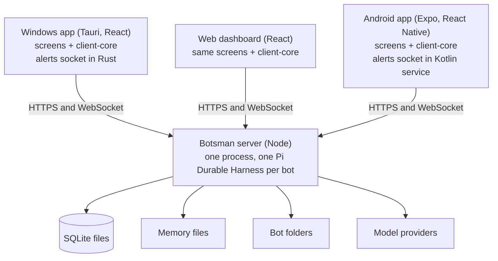

# Architecture overview



## Server

One Node process runs as the owner's user, as a systemd user service. It needs no root once installed. It owns all state, and no other process writes to its storage.

```text
~/.botsman/
  server.db                 login, tokens, bot registry, settings, encrypted model keys and sign-ins
  secret.key                the key that encrypts model keys and signs access tokens, left out of backups
  user/USER_PROFILE.md
  user/USER_MEMORY.md
  skills/                   shared skill pool
  bots/<id>/session.sqlite  Pi Durable storage for that bot
  bots/<id>/BOT_PROFILE.md
  bots/<id>/BOT_MEMORY.md
  bots/<id>/notes/
  workspaces/<id>/          the default bot folder, the only writable path in its sandbox
```

Memory files and notes sit outside the bot's folder, so its sandbox hides them, and a bot can only reach them through the `memory` tool. Edits to memory files ask for confirmation.

### Bot folders

The owner chooses a bot's folder when creating it, so a bot that clones large repos can sit on a disk with room for them. The path is on the server, so the form shows the server's free space. Left empty, the folder is `~/.botsman/workspaces/<id>`. A path may start with `~/`, which the server reads as the owner's home folder. The form checks the folder and shows the free space as the owner types, and a new bot's default model is the main bot's default.

A bot gets read-write access to its whole folder, so the server refuses any path that would expose something else:

- `/` and the owner's home folder
- `~/.ssh`, `~/.claude`, and `~/.agents`
- Botsman's own data, other than the default folder
- the backups folder, which holds copies of that data
- another bot's folder

Those checks also apply to anything inside these paths. Chat history, memory files, and notes stay in `~/.botsman` wherever the folder is.

### Skills

Botsman follows the [Agent Skills](https://agentskills.io) convention. A bot's skill list comes from three places:

| Folder | Holds | Bot's access |
| --- | --- | --- |
| `~/.botsman/skills/` | The shared pool, which only the main bot adds to | Read-only |
| `~/.agents/skills/` | The owner's skills, shared with other tools on the server | Read-only |
| `.agents/skills/` in the bot's folder | That bot's own skills | Read-write |

Each bot has a toggle for every skill in the first two folders, off by default, so the owner turns on only what that bot needs. A skill that is off isn't in the bot's skill list. Its files stay readable through the read-only mount. A bot's own skills are always on.

Botsman doesn't load skills from repos cloned into a bot's folder. The bot's skill list gives each skill's full path, because `~` inside a sandbox is the bot's own folder. See [how the sandbox is set up](permissions.md#how-the-sandbox-is-set-up).

### Main parts

| Module | Job |
| --- | --- |
| `engine` | The only code that imports Pi Durable. Opens a Harness per bot, starts conversations, and watches them. |
| `claude-agent` | A custom `pi-ai` provider that runs Claude models through Claude Code. Imports the Agent SDK, not Pi Durable. |
| `api` | Fastify HTTP routes and the WebSocket. Login, rate limits, and token refresh. Serves the web dashboard's files. |
| `events` | Turns Pi's conversation state changes into our own app events. |
| `permissions` | The `beforeTool` hook, approvals, the classifier, and approval waits. |
| `sandbox` | Builds each bot's `bwrap` allow list, starts its `pi-env` daemon, and checks at startup that sandboxes work. |
| `memory` | The four files, the checks on memory edits, sending changes to bots, and the pre-compaction save. |
| `notes` | Keyword index over each bot's notes. |
| `routines` | Durable sleep tasks that run each routine on schedule. |
| `conversations` | Bot-to-bot exchanges, channels, and the loop limit. |
| `tools` | The `memory` tool, web, messaging, and main bot tools, including `host_bash`. Skills and MCP adapters. |
| `alerts` | Decides which events alert, and streams them to apps. |
| `auth` | The owner's password, device sessions, and access and refresh tokens. |
| `bots` | The bot registry, folder rules, and creating, editing, and deleting bots. |
| `providers` | pi-ai's credential store over `server.db`, the provider list, and sign-ins. |
| `backup` | Nightly backups and the backup command. |

In M1 the `events` module receives Pi's conversation views from the engine as plain data and never imports Pi Durable itself, so the engine is the only importer. Alerts and the `server` stream are published from the service wiring in `server/src/services.ts`. `routines`, `conversations`, and the rest of `tools` come in later milestones.

### Conversations in Pi

Each bot's SQLite file holds its chat with the owner, routine runs, its side of bot-to-bot exchanges, and channel conversations. Each is a separate Pi conversation. [Conversations](conversations.md) sets out what each one sees.

## Protocol

Our own schema, in the `protocol` package, defines every HTTP body and WebSocket message. Apps never see Pi's internal formats, so a Pi upgrade changes only the `engine` and `events` modules.

- **Live updates.** The WebSocket sends events with a per-conversation sequence number. A client signs in with its first message, since browsers can't set headers on a WebSocket.
- **Streamed text.** A chat's snapshot carries its full live state, and after that each `live_patch` event carries only what changed since the previous live event on the stream. The server sends a patch for every Pi commit that changes the live state, as soon as it arrives. Pi commits streamed text, thinking, and each running tool's output at most every 100 ms each, so a plain reply gets about 10 updates a second.
  - A text changes in one of three ways: it grows at the end, it drops from the front and grows (bash keeps its output as a 50 KB tail), or it's cleared. All three are one shape, `{ drop, append, length, hash }`: the new text is the old text minus `drop` characters from its start, plus `append`. The server works out `drop` with Chord's `overlap()`, the function Pi itself uses to commit a changed string, looking back up to 65,536 characters as Pi does. When it finds no shared part, for example in a window whose start repeats too often to place, the whole text goes, which is still exact. Working out patches is server code (`server/src/events/live-diff.ts`). `protocol` holds only what both sides need: the patch types and the hash. Applying and checking a patch is client code, in `client-core` (`packages/client-core/src/live-patch.ts`).
  - Tools go as one entry per tool that changed, holding only its changed fields, its running output among them. A call id the client doesn't know is a new tool and comes with its name and status. `toolsCleared` ends a round. A tool's final result still arrives once, as a `tool_result` message.
  - `length` and `hash` (32-bit FNV-1a over the UTF-16 units) describe the result. The client checks `drop` and `length` on every patch, and the hash once per changed text when it draws. An unknown tool without a name fails the check too. A failed check keeps the screen as it is, and `StreamConnection.resync` throws away the stream's position and subscribes without one, so the server sends a fresh snapshot. Events already on their way are dropped until it lands. A stream asks at most once every 10 seconds, so after a second failure within that time the chat stays as it was for up to 10 seconds. That only happens when there's a bug.
  - WebSocket compression isn't used. Its window is at most 32 KB, so it can't reach back far enough to match a reply longer than that.

  Clients gather live updates before redrawing, for 50 ms plus 1 ms for every 100 characters streamed so far, up to a second, since each redraw lays out the whole reply again. Updates that pile up while a slow device is still drawing become one redraw. Patches that arrive while a redraw waits are folded in order onto the waiting state, and a message, totals or settings event first draws what's waiting. A reply's Markdown redraws only when its own text changes. On Android, streamed text fades in only while the reply is under 4,000 characters, since each fade redraws the whole reply every frame.
- **Reconnect.** The client sends the server's epoch and the last sequence it saw, and the server replies with what it missed or a fresh snapshot. A snapshot is the state as of its sequence number, and a catch-up applies its patches in order on top of the state the client holds, including patches still waiting to be drawn. A stream with no listeners records no position, so the next screen to open it starts from a snapshot. The server keeps the last 1,000 events per stream in memory, and its epoch changes on every start, so a client returning after a restart gets a snapshot.
- **Working.** Each bot's line also says whether it is replying or running tools right now, and both bot lists show "Working" with a pulsing dot while it is.
- **Bot list order.** The main bot is pinned first. The rest follow by their latest message, newest first, so the order changes as chats move. Bots with no messages yet come last, newest bot first.
- **Bot list activity.** The `server` stream carries each bot's last message time, a one-line preview of its newest message, and its count of unread replies. One read marker per bot lives in `server.db`, so every device shows the same count. A chat open on any screen moves the marker to its newest message, and the marker only moves forward. Bots that existed before markers were added start as read. The count covers the messages the chat currently holds, up to its last compaction.
- **Usage history.** The server writes one row per bot reply to `server.db`, with its tokens and cost, when the reply first appears. `/api/usage` totals them by day and by bot over a number of days, with days on the app's clock from the timezone offset it sends. History starts when the server first records it.
- **Alerts stream.** A second, small stream carries only alert events, for the background connections.
- **Protocol version.** The package holds one whole number that goes up on a breaking change. The server reports the range it accepts in `/api/health`, with its release version, commit, and the newest server release it knows of, and an app outside that range stops with a screen that says which side to update. Adding a field leaves the number alone: apps treat a field a newer server added as possibly missing. An event an app doesn't know isn't ignored, since `applyChatEvent` treats any unknown chat event as settings, so adding or replacing a chat event breaks older apps. `live_patch` replaced `live` without raising the number, because the released 0.1.0 apps had no users yet: a 0.1.0 app's chat screen breaks on a newer server, and so does a web dashboard tab loaded before the server upgrade, until it's reloaded. See [versions and releases](stack.md#versions-and-releases).

Rust and Kotlin message types for the alerts stream are generated from the same JSON Schema.

## Apps

The `client-core` package holds login, reconnect, catch-up, state, approvals, sending, and retries, in plain TypeScript with no DOM dependency. React hooks wrap it, so a screen on either app gets the same data and actions.

Only `client-core` and the server depend on `protocol`. `client-core` re-exports the protocol's types with `export type *`, so screens take message types such as `Bot` from `client-core`. The re-export carries types only, so the protocol's functions can't be called from a screen.

Where code goes:

- **`protocol`** holds what both sides must agree on: message types, stream names, the version check, and each limit and pattern the server enforces, such as the shortest owner password, `BotLimits`, and the note name pattern. The server and `client-core` read those and never write the numbers again. `botIdOfStream` stays here though only the server calls it, because it reverses `chatStream`. `protocolFit` and `compareVersions` stay here as part of the version contract, though only `client-core` decides with `protocolFit`. Code that only builds or checks the package, such as the alerts JSON Schema, lives in its `scripts`.
- **`client-core`** holds every rule, state, and text that depends on state for the screens. A screen or form whose logic both apps need has one hook, such as `useModelPicker` or `useSetUpForm`, with its decisions in plain functions that have tests. A form's `submit` does nothing until the form is ready, so the keyboard's Enter and the button agree.
- **Screens** hold layout, styling, navigation, fixed wording, and calls to the platform, such as the clipboard and photo picker. A line about what the platform does, such as how an update installs, comes from the screen.
- **`tokens`** holds sizes and shapes both apps draw, such as how much of a bot's picture its mark fills.
- **Native alerts code** fills a bot's name into the wording itself, because Kotlin and Rust can't call `client-core`.

Both apps name the server in the line under the bot list, "Connected to" and "Reconnecting to" followed by its host, and label the memory files without `.md`, so the labels fit a phone.

Its main parts:

| Part | Job |
| --- | --- |
| `AppController` | Takes an app from launch to a signed-in connection: the server address, the protocol check, first-run setup or sign-in, and back to sign-in when the session ends. Each step is one screen. |
| `Session` | Signs in, renews tokens before they run out, and repeats a request once after a renewal. Parallel requests share one renewal, because a refresh token works once. A renewal keeps the same session, so screens following the sign-in don't start over. |
| `StreamConnection` | The live socket. It reconnects with a growing delay, pings to notice a silent drop, and asks each stream for what it missed. `resync` asks a stream for a fresh snapshot after an update fails its check, at most once every 10 seconds. |
| `ChatController` | One bot's chat. A sent message shows at once as pending, and a failed one stays with Retry and Discard. A pending message clears once the server has accepted it and the chat shows its text, so an earlier message with the same text can't hide a send that then fails. A retry reuses the request id, so the server can't run it twice. Live patches fold onto the waiting state while it waits to redraw. |
| `chatItems` | Turns a chat's state into the list both apps draw: replies with their tool calls and results inside them, then what is live, queued, and pending. |
| `offeredSendModes` | The send rule: Send while idle, Queue or Steer while busy. |
| Screen hooks | Each screen's state and actions, such as the message box, the memory and note editors, the new-bot form, signed-in devices, and the background status. Both apps call the same hook and pass in only what differs, such as how to move to another screen. |

The `pc-ui` package holds the Windows and web screens, and Android builds its own on the same hooks.

Android's screens are separate, because the best Android chat needs native views. Between Android and the other two apps, roughly 40% of client code is shared, by estimate: nearly all logic and none of the screens.

`apps/windows` and `apps/web` are thin shells around `pc-ui`, so the web dashboard needs no screens of its own. Both depend on `pc-ui` alone. `pc-ui` re-exports `client-core`'s types, the protocol's among them, with `export type *`, so a shell takes the platform interfaces it implements, such as `TokenStore` and `AppUpdater`, from `pc-ui`.

| Need | Windows | Web | Android |
| --- | --- | --- | --- |
| Screens | `pc-ui` (React, shadcn) | `pc-ui` (React, shadcn) | React Native, our own components |
| Alerts connection | Rust, in Tauri | The open page's WebSocket | Kotlin foreground service |
| Token storage | Credential Manager | `HttpOnly`, `Secure`, `SameSite` cookie | Keystore |
| Local cache | IndexedDB | IndexedDB | SQLite |
| Auto-start | Tauri | None | Boot receiver |
| HTTP requests | Tauri's HTTP plugin, sent from Rust | The browser's `fetch` | React Native's `fetch` |
| Updates | Tauri's updater, from GitHub Releases | Comes with the server | Its own download and install, from GitHub Releases |

The alerts connection runs when the UI does not, so it can't live in `client-core`. Its logic stays small: connect, catch up, show a notification.

`client-core` takes `fetch` and token storage as inputs, and each shell supplies its own. `pc-ui` reaches the tray, notifications, and updates through one small platform interface. `apps/windows` implements it with Tauri calls. `apps/web` implements it with browser features, and marks the rest as absent so the screen hides them.

Android draws Markdown to match the PC: a quote is a thin rule with muted text and no fill, inline code sits on the muted colour with no border, and tables and code blocks sit on the card colour with a border. On every app, a web or mail link in a reply opens in the default browser or mail app, and other links do nothing, so a link a bot copied from a web page can't take over the app's window.

Settings has a Mode choice of System, Light, or Dark, kept on each device: local storage on Windows and the web, and the phone's secure storage on Android. System follows the device's setting as it changes. Dark is Zoetrik, and Light is its Drafting Table scheme.

Bot faces are one of eight built-in line marks, kept as path data in the `tokens` package and drawn with SVG on both apps, or a photo. A picked photo is cropped square and shrunk to a 256-pixel JPEG on the device before upload: a canvas in `pc-ui`, and Expo's image picker and image manipulator on Android. A bot without a face shows its initial.

Bot settings offers approval waits of 15 minutes, 1 hour, 8 hours, 1 day, and 7 days. The server accepts one minute to seven days, so "until answered" is not offered, and a wait set to another value shows as its own choice. The Smart mode's note says it currently runs like Off. The connections and skills sections stay hidden until M4.

First-run setup has two steps: the owner password and the main bot's name, which create the owner and the main bot together, then "Add a model provider" with the same list as Settings. Continue needs a connected provider, and Skip for now leaves it for later. On Continue the main bot gets the first connected model as its default when it has none.

Model providers list every provider with its status, and connect it with an API key or the server-run sign-in. A sign-in's steps arrive on the `server` stream. The app keeps the first reply to starting one and takes everything after from the stream, since the stream can be ahead of an HTTP reply. A sign-in link opens in the system browser. A chat whose model is missing, or whose provider isn't connected, shows why above the message box with a link to the providers. The message box has a toolbar under the text: attach and image buttons, shown disabled until attachments arrive in M4, the model chip showing the chat's model and the effort it runs at, and a Send arrow. While the bot works the Send arrow gives way to Queue, Steer, and a red Stop, and the box asks to queue a message. On a phone those three sit on their own row under the toolbar, so they never crowd the chip. The picker closes when the owner taps outside it or taps the chip again. The model chip opens the model and reasoning picker, a panel above the box on the PC and a sheet from the bottom on Android, which changes either the open chat or the bot's default. Bot info's Model default row opens the same picker for the default alone. The chat header's line is plain text. The picker offers each model's own reasoning levels, from Pi's catalog for the pinned version, out of Off, Minimal, Low, Medium, High, Extra high, and Max. When a chat's saved level isn't one its model has, the picker and the chat header show the level Pi will really use: the next one up the model has, or else the next one down.

A chat draws each run, everything the bot does for one owner message, as one reply. The bot's text replies stay in view in order. The thinking and tool calls between two of them fold into one line, such as "Thought · ran 3 tools", or what is running while it is live. An approval stays in view outside its fold. An attempt that failed and was retried, such as a reply cut off when the provider's connection dropped, is left out. A run that ends in an error shows it. Tokens and cost appear once, for the whole run, when it ends, with Copy beside them, which copies everything the bot said in the run without its thinking or tool calls. From the moment the bot starts until the first words arrive, the run shows "Working…". The chat header shows how full the context is, as the newest reply's token count against the model's context window, such as "2.4k/1M context". The message box grows with what is typed, wrapped lines included, up to 40% of the window, then scrolls.

Slash commands cover compact, clear, memory, notes, and usage, and `/skills` follows with M4. Typing `/` already lists them, so there is no `/help`. A message that is one word starting with `/` shows the matching commands, and sending an exact command runs it instead of sending it to the bot. Usage shows the last 14 days by day and by bot, with deleted bots added together. Settings holds the alert switches for the kinds that can happen so far, approvals and failures, the signed-in devices with a way to sign another one out, model providers, the server's version, the app's update, and the server. Sign out and Change server wait for each other, show an error if one fails, and Change server shows only where the app's address can change. The server's version line names the branch and commit on a preview server. When a newer server release exists, the server section says so and shows the command to run on the server, and the "Update the server" screen shows the same command, or the preview server's own command when connected to one. The PC footer and the phone's bot list link to Usage and Settings.

The local cache keeps the last server state and each opened chat's newest 50 messages on the device, under the server's address, so the bot list and a chat show at once at launch. They show as cached until the live snapshot replaces them, and live state such as a running reply is never cached. Writes wait a second after the last change. Signing out clears the cache.

The server serves the dashboard from its own origin, so the dashboard needs no CORS rules. The server builds the dashboard's files during install and has no build step of its own.

### Dashboard sign-in

The dashboard asks for its session in cookies by sending `cookie: true` at setup and sign-in. The server then sets two cookies and answers with only the session's id and expiry times, so no page script ever holds a token.

| Cookie | Sent to | Holds |
| --- | --- | --- |
| `botsman_access` | `/api` | The access token |
| `botsman_refresh` | `/api/auth` | The refresh token |

Both are `HttpOnly`, `Secure`, and `SameSite=Strict`. A browser attaches cookies to requests that another site starts, so the server also checks the `Origin` header against its own address:

- before starting or renewing a cookie session
- on every cookie-authenticated request that is not a `GET` or `HEAD`
- before a WebSocket may sign in with the cookie, which the dashboard asks for by sending an empty token in `hello`

The apps keep sending a bearer token, and none of these checks apply to them.

The dashboard's page carries a content security policy that allows only its own files and connections to its own server. It blocks inline fonts, so the dashboard's build keeps every font as a separate file. Files under `assets/` have a content hash in their names and are cached for a year. The page itself is never cached.

## Parity

- Screens get everything through shared hooks and hold no logic.
- One recorded set of events runs through the chat state and `chatItems`, which is all either chat screen draws. It is a real stream from the server with the scripted model: a reply, a tool call that waits for approval, a failed reply and its retry, and a clear. It lives in `packages/client-core/test/fixtures/chat-recording.json`, and `RECORD_CHAT=1` records it again after a change to the stream. Reconnects are covered by the live client tests.
- `DESIGN.md` and a shared token file define the look.
- The PC screens are tested on the web dashboard in a browser, and the Android screens on a real phone. The owner checks the Windows-only parts by hand: the tray, auto-start, Credential Manager, and the installer.

## Deleting a bot

Deleting a bot sets `deleted_at` on its row in the bot registry. Nothing is erased, and the main bot can't be deleted.

- The server leaves a deleted bot out of everything it sends the apps: the bot list, Needs you, alerts, routines, memory, notes, and its conversations with other bots.
- Lines for those conversations disappear from other bots' chats. Past channel messages stay, so the channel still reads correctly.
- Past costs stay in the usage total, grouped as "Deleted bots".
- Its routines stop, its pending approvals, memory edits included, are cancelled, and its sandboxes stop.
- Other bots can't find it or message it. The main bot sees it only through its restore tools.
- Its SQLite file, memory files, notes, and folder stay on disk and in backups. Its name is free to reuse.

Only the main bot can restore a deleted bot, using a tool that lists deleted bots and one that restores them. A restore is a change to another bot, so it follows the main bot's approval mode. The bot returns with its chat, files, and conversations. Its routines stay paused until the owner resumes them, and requests refused during the deletion stay refused. If another bot has taken its name, the main bot asks the owner for a new one.

The apps have no permanent erase in v1. That is done on the server by hand.

## Exposure

The server does not care whether its address is on a tailnet or the public internet. It requires HTTPS and treats every deployment as reachable by strangers: rate-limited login, and revocable refresh tokens. TLS comes from Tailscale, a reverse proxy such as Caddy, or certificate files given to the server. The server listens on `127.0.0.1` by default and refuses any request that didn't arrive over TLS, judged from its own TLS or a trusted proxy's `X-Forwarded-Proto`. Login allows 10 wrong passwords per address and 30 in all every 15 minutes. Each attempt is counted before the password is checked, so parallel guesses can't slip under the caps, and any outcome other than a wrong password gives its count back. The overall cap stops a local process that fakes `X-Forwarded-For` from posing as many addresses. The cost is that a stranger who keeps sending wrong passwords blocks new sign-ins for as long as they keep it up. Devices already signed in keep working, because refreshing a token is not a sign-in. Setup has its own limit of 10 attempts per address every 15 minutes. Access tokens last 15 minutes and refresh tokens 60 days from their last use; each refresh replaces the refresh token. Both WebSockets recheck the device's session every minute, so a revoked device loses them, and refuse any client message over 64 KiB. See [running the server](../operations/server.md).

## To settle during the build

- How snapshots of a bot's folder work.
- Whether a bot's folder can move after creation.
- Which web search provider to use.
- Which model the smart approval classifier uses.
