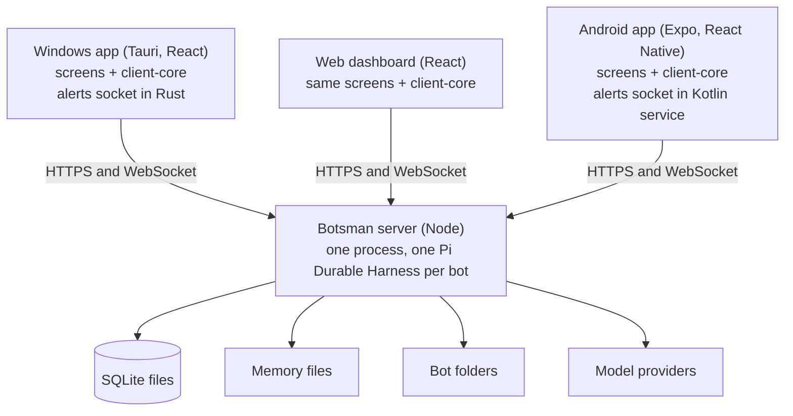

# Architecture overview



## Server

One Node process runs as the owner's user, as a systemd user service. It needs no root once installed. It owns all state, and no other process writes to its storage.

```text
~/.botsman/
  server.db                 login, tokens, bot registry, settings, encrypted model keys and sign-ins
  secret.key                the key that encrypts model keys and signs access tokens, left out of backups
  user/USER_PROFILE.md
  user/USER_MEMORY.md
  skills/                   shared skill pool
  bots/<id>/session.sqlite  Pi Durable storage for that bot
  bots/<id>/BOT_PROFILE.md
  bots/<id>/BOT_MEMORY.md
  bots/<id>/notes/
  workspaces/<id>/          the default bot folder, the only writable path in its sandbox
```

Memory files and notes sit outside the bot's folder, so its sandbox hides them, and a bot can only reach them through the `memory` tool. Edits to memory files ask for confirmation.

### Bot folders

The owner chooses a bot's folder when creating it, so a bot that clones large repos can sit on a disk with room for them. The path is on the server, so the form shows the server's free space. Left empty, the folder is `~/.botsman/workspaces/<id>`.

A bot gets read-write access to its whole folder, so the server refuses any path that would expose something else:

- `/` and the owner's home folder
- `~/.ssh`, `~/.claude`, and `~/.agents`
- Botsman's own data, other than the default folder
- the backups folder, which holds copies of that data
- another bot's folder

Those checks also apply to anything inside these paths. Chat history, memory files, and notes stay in `~/.botsman` wherever the folder is.

### Skills

Botsman follows the [Agent Skills](https://agentskills.io) convention. A bot's skill list comes from three places:

| Folder | Holds | Bot's access |
| --- | --- | --- |
| `~/.botsman/skills/` | The shared pool, which only the main bot adds to | Read-only |
| `~/.agents/skills/` | The owner's skills, shared with other tools on the server | Read-only |
| `.agents/skills/` in the bot's folder | That bot's own skills | Read-write |

Each bot has a toggle for every skill in the first two folders, off by default, so the owner turns on only what that bot needs. A skill that is off isn't in the bot's skill list. Its files stay readable through the read-only mount. A bot's own skills are always on.

Botsman doesn't load skills from repos cloned into a bot's folder. The bot's skill list gives each skill's full path, because `~` inside a sandbox is the bot's own folder. See [how the sandbox is set up](permissions.md#how-the-sandbox-is-set-up).

### Main parts

| Module | Job |
| --- | --- |
| `engine` | The only code that imports Pi Durable. Opens a Harness per bot, starts conversations, and watches them. |
| `claude-agent` | A custom `pi-ai` provider that runs Claude models through Claude Code. Imports the Agent SDK, not Pi Durable. |
| `api` | Fastify HTTP routes and the WebSocket. Login, rate limits, and token refresh. Serves the web dashboard's files. |
| `events` | Turns Pi's conversation state changes into our own app events. |
| `permissions` | The `beforeTool` hook, approvals, the classifier, and approval waits. |
| `sandbox` | Builds each bot's `bwrap` allow list, starts its `pi-env` daemon, and checks at startup that sandboxes work. |
| `memory` | The four files, the checks on memory edits, sending changes to bots, and the pre-compaction save. |
| `notes` | Keyword index over each bot's notes. |
| `routines` | Durable sleep tasks that run each routine on schedule. |
| `conversations` | Bot-to-bot exchanges, channels, and the loop limit. |
| `tools` | The `memory` tool, web, messaging, and main bot tools, including `host_bash`. Skills and MCP adapters. |
| `alerts` | Decides which events alert, and streams them to apps. |
| `auth` | The owner's password, device sessions, and access and refresh tokens. |
| `bots` | The bot registry, folder rules, and creating, editing, and deleting bots. |
| `providers` | pi-ai's credential store over `server.db`, the provider list, and sign-ins. |
| `backup` | Nightly backups and the backup command. |

In M1 the `events` module receives Pi's conversation views from the engine as plain data and never imports Pi Durable itself, so the engine is the only importer. Alerts and the `server` stream are published from the service wiring in `server/src/services.ts`. `routines`, `conversations`, and the rest of `tools` come in later milestones.

### Conversations in Pi

Each bot's SQLite file holds its chat with the owner, routine runs, its side of bot-to-bot exchanges, and channel conversations. Each is a separate Pi conversation. [Conversations](conversations.md) sets out what each one sees.

## Protocol

Our own schema, in the `protocol` package, defines every HTTP body and WebSocket message. Apps never see Pi's internal formats, so a Pi upgrade changes only the `engine` and `events` modules.

- **Live updates.** The WebSocket sends events with a per-conversation sequence number. A client signs in with its first message, since browsers can't set headers on a WebSocket.
- **Reconnect.** The client sends the server's epoch and the last sequence it saw, and the server replies with what it missed or a fresh snapshot. The server keeps the last 1,000 events per stream in memory, and its epoch changes on every start, so a client returning after a restart gets a snapshot.
- **Bot list activity.** The `server` stream carries each bot's last message time, a one-line preview of its newest message, and its count of unread replies. One read marker per bot lives in `server.db`, so every device shows the same count. A chat open on any screen moves the marker to its newest message, and the marker only moves forward. Bots that existed before markers were added start as read. The count covers the messages the chat currently holds, up to its last compaction.
- **Usage history.** The server writes one row per bot reply to `server.db`, with its tokens and cost, when the reply first appears. `/api/usage` totals them by day and by bot over a number of days, with days on the app's clock from the timezone offset it sends. History starts when the server first records it.
- **Alerts stream.** A second, small stream carries only alert events, for the background connections.
- **Protocol version.** The package holds one whole number that goes up on a breaking change. The server reports the range it accepts, and an app outside that range stops with a screen that says which side to update. Adding a field or an event leaves the number alone: apps ignore what they don't know, and treat a field a newer server added as possibly missing. See [versions and releases](stack.md#versions-and-releases).

Rust and Kotlin message types for the alerts stream are generated from the same JSON Schema.

## Apps

The `client-core` package holds login, reconnect, catch-up, state, approvals, sending, and retries, in plain TypeScript with no DOM dependency. React hooks wrap it, so a screen on either app gets the same data and actions.

Its main parts:

| Part | Job |
| --- | --- |
| `AppController` | Takes an app from launch to a signed-in connection: the server address, the protocol check, first-run setup or sign-in, and back to sign-in when the session ends. Each step is one screen. |
| `Session` | Signs in, renews tokens before they run out, and repeats a request once after a renewal. Parallel requests share one renewal, because a refresh token works once. |
| `StreamConnection` | The live socket. It reconnects with a growing delay, pings to notice a silent drop, and asks each stream for what it missed. |
| `ChatController` | One bot's chat. A sent message shows at once as pending, and a failed one stays with Retry and Discard. A retry reuses the request id, so the server can't run it twice. |
| `chatItems` | Turns a chat's state into the list both apps draw: replies with their tool calls and results inside them, then what is live, queued, and pending. |
| `offeredSendModes` | The send rule: Send while idle, Queue or Steer while busy. | The `pc-ui` package holds the Windows and web screens, and Android builds its own on the same hooks.

Android's screens are separate, because the best Android chat needs native views. Between Android and the other two apps, roughly 40% of client code is shared, by estimate: nearly all logic and none of the screens.

`apps/windows` and `apps/web` are thin shells around `pc-ui`, so the web dashboard needs no screens of its own.

| Need | Windows | Web | Android |
| --- | --- | --- | --- |
| Screens | `pc-ui` (React, shadcn) | `pc-ui` (React, shadcn) | React Native, our own components |
| Alerts connection | Rust, in Tauri | The open page's WebSocket | Kotlin foreground service |
| Token storage | Credential Manager | `HttpOnly`, `Secure`, `SameSite` cookie | Keystore |
| Local cache | IndexedDB | IndexedDB | SQLite |
| Auto-start | Tauri | None | Boot receiver |
| HTTP requests | Tauri's HTTP plugin, sent from Rust | The browser's `fetch` | React Native's `fetch` |
| Updates | Tauri's updater, from GitHub Releases | Comes with the server | Its own download and install, from GitHub Releases |

The alerts connection runs when the UI does not, so it can't live in `client-core`. Its logic stays small: connect, catch up, show a notification.

`client-core` takes `fetch` and token storage as inputs, and each shell supplies its own. `pc-ui` reaches the tray, notifications, and updates through one small platform interface. `apps/windows` implements it with Tauri calls. `apps/web` implements it with browser features, and marks the rest as absent so the screen hides them.

Bot faces are one of eight built-in line marks, kept as path data in the `tokens` package and drawn with SVG on both apps, or a photo. A picked photo is cropped square and shrunk to a 256-pixel JPEG on the device before upload: a canvas in `pc-ui`, and Expo's image picker and image manipulator on Android. A bot without a face shows its initial.

Bot settings offers approval waits of 15 minutes, 1 hour, 8 hours, 1 day, and 7 days. The server accepts one minute to seven days, so "until answered" is not offered, and a wait set to another value shows as its own choice. The Smart mode's note says it currently runs like Off. The connections and skills sections stay hidden until M4.

The server serves the dashboard from its own origin, so the dashboard needs no CORS rules. The server builds the dashboard's files during install and has no build step of its own.

### Dashboard sign-in

The dashboard asks for its session in cookies by sending `cookie: true` at setup and sign-in. The server then sets two cookies and answers with only the session's id and expiry times, so no page script ever holds a token.

| Cookie | Sent to | Holds |
| --- | --- | --- |
| `botsman_access` | `/api` | The access token |
| `botsman_refresh` | `/api/auth` | The refresh token |

Both are `HttpOnly`, `Secure`, and `SameSite=Strict`. A browser attaches cookies to requests that another site starts, so the server also checks the `Origin` header against its own address:

- before starting or renewing a cookie session
- on every cookie-authenticated request that is not a `GET` or `HEAD`
- before a WebSocket may sign in with the cookie, which the dashboard asks for by sending an empty token in `hello`

The apps keep sending a bearer token, and none of these checks apply to them.

The dashboard's page carries a content security policy that allows only its own files and connections to its own server. Files under `assets/` have a content hash in their names and are cached for a year. The page itself is never cached.

## Parity

- Screens get everything through shared hooks and hold no logic.
- One recorded set of events (a streaming reply, an approval, a reconnect) runs through both chat screens, for side-by-side comparison.
- `DESIGN.md` and a shared token file define the look.
- The PC screens are tested on the web dashboard in a browser, and the Android screens on a real phone. The owner checks the Windows-only parts by hand: the tray, auto-start, Credential Manager, and the installer.

## Deleting a bot

Deleting a bot sets `deleted_at` on its row in the bot registry. Nothing is erased, and the main bot can't be deleted.

- The server leaves a deleted bot out of everything it sends the apps: the bot list, Needs you, alerts, routines, memory, notes, and its conversations with other bots.
- Lines for those conversations disappear from other bots' chats. Past channel messages stay, so the channel still reads correctly.
- Past costs stay in the usage total, grouped as "Deleted bots".
- Its routines stop, its pending approvals, memory edits included, are cancelled, and its sandboxes stop.
- Other bots can't find it or message it. The main bot sees it only through its restore tools.
- Its SQLite file, memory files, notes, and folder stay on disk and in backups. Its name is free to reuse.

Only the main bot can restore a deleted bot, using a tool that lists deleted bots and one that restores them. A restore is a change to another bot, so it follows the main bot's approval mode. The bot returns with its chat, files, and conversations. Its routines stay paused until the owner resumes them, and requests refused during the deletion stay refused. If another bot has taken its name, the main bot asks the owner for a new one.

The apps have no permanent erase in v1. That is done on the server by hand.

## Exposure

The server does not care whether its address is on a tailnet or the public internet. It requires HTTPS and treats every deployment as reachable by strangers: rate-limited login, and revocable refresh tokens. TLS comes from Tailscale, a reverse proxy such as Caddy, or certificate files given to the server. The server listens on `127.0.0.1` by default and refuses any request that didn't arrive over TLS, judged from its own TLS or a trusted proxy's `X-Forwarded-Proto`. Login allows 10 wrong passwords per address and 30 in all every 15 minutes. Each attempt is counted before the password is checked, so parallel guesses can't slip under the caps, and any outcome other than a wrong password gives its count back. The overall cap stops a local process that fakes `X-Forwarded-For` from posing as many addresses. The cost is that a stranger who keeps sending wrong passwords blocks new sign-ins for as long as they keep it up. Devices already signed in keep working, because refreshing a token is not a sign-in. Setup has its own limit of 10 attempts per address every 15 minutes. Access tokens last 15 minutes and refresh tokens 60 days from their last use; each refresh replaces the refresh token. Both WebSockets recheck the device's session every minute, so a revoked device loses them, and refuse any client message over 64 KiB. See [running the server](../operations/server.md).

## To settle during the build

- How snapshots of a bot's folder work.
- Whether a bot's folder can move after creation.
- Which web search provider to use.
- Which model the smart approval classifier uses.
