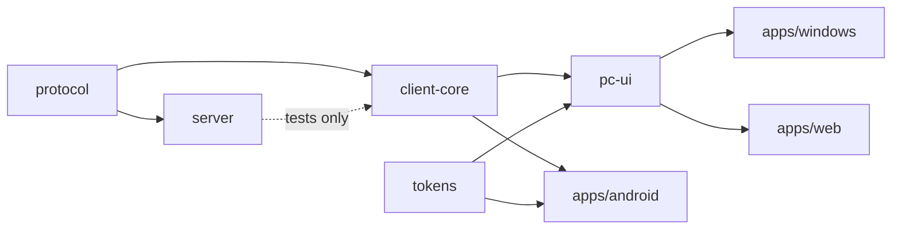

# Technology stack

## Choices

| Layer | Choice | Why |
| --- | --- | --- |
| Language | TypeScript, with a little Rust and Kotlin in the app shells | Pi Durable requires it on the server |
| Repo | One monorepo, pnpm 12.18.0 workspaces | The server and apps share code directly. See [why pnpm](#why-pnpm). |
| Runtime | Node 24, pinned to 24.21 in `.node-version` | Pi needs 22.19 or newer, and our Pi tests ran on 24.21. The server runs its TypeScript directly with Node's type stripping, with no build step. |
| Agent engine | Pi Durable 1.5.0, exact version | Crash recovery, durable waits, and many conversations in one store |
| Models | `pi-ai` | About 35 providers, including a built-in `opencode-go` |
| Claude subscription | `@anthropic-ai/claude-agent-sdk`, as a custom `pi-ai` provider | Runs the owner's own Claude Code login with Pi keeping control of tools and history |
| Skills | The loader from `pi-coding-agent` | Reads [Agent Skills](https://agentskills.io) `SKILL.md` folders |
| MCP | `pi-mcp`, with our own adapter into Pi Durable tools | A complete client with OAuth; Pi Durable has no adapter |
| HTTP and WebSocket | Fastify 5.12.7 with `@fastify/websocket` 11.3.4 | Node-only, with JSON Schema validation built in |
| Message schema | `pi-schema` | Already installed through Pi, no dependencies, no `eval`, and outputs plain JSON Schema. Fastify validates with it directly. Zod 4 appears only in the `claude-agent` module, because the Agent SDK's tool helper requires it. |
| Storage | One Pi SQLite file per bot, and `server.db` through `node:sqlite` with plain SQL | Per-bot backup. A few tables need no ORM. |
| Search | SQLite FTS5 | Built in, and tested with `node:sqlite` |
| Windows app | Tauri 2.12.5, React 19.3.0, Vite 8.3.8, Tailwind 4.3.5, shadcn | Tray, small installer, and WebView2 |
| Windows token storage | The `keyring` crate 4.2.0 | Writes to Windows Credential Manager from Rust |
| Markdown on Windows and web | `react-markdown` 10.1.0 with `remark-gfm` 4.0.1 | Renders to React elements with no raw HTML, and covers tables |
| Fonts | Orbitron, Inter, and Fragment Mono shipped inside each app, from `@fontsource` on Windows and web and `@expo-google-fonts` on Android | The apps draw the same offline, and ask no outside host for fonts |
| Web dashboard | The same React screens in a browser, served by the server | No screens to build twice |
| Android app | Expo 58.0.25, React Native 0.88.1. Native libraries at the versions `expo install` picks. | Native chat feel, and shares TypeScript with everything else |
| Keyboard | `react-native-keyboard-controller` | Tracks the keyboard natively |
| Chat list | Legend List's chat component, with FlashList as fallback | See [risks](../risks.md) for its open keyboard bug |
| Markdown | `react-native-enriched-markdown` | Native text, streaming, code highlighting, and tables |
| Android styling | React Native `StyleSheet` and a shared token file | NativeWind's Tailwind 4 version is still a release candidate |
| Alerts on Android | Our own Kotlin foreground service, as an Expo module | See [notifications](notifications.md) |
| Bot isolation | Bubblewrap, one sandbox per bot | An allow list of paths, separate processes per bot, no root after install, and about 30 ms to start |
| Windows HTTP | Tauri's HTTP plugin, which sends each request from Rust | The webview's origin differs from the server's, so a request from the page would need CORS headers on the server. Rust has no such rule. `client-core` takes `fetch` as an input, so the API client is written once. |
| App updates | Tauri's updater plugin on Windows, and our own installer step on Android | See [versions and releases](#versions-and-releases) |
| Hosting | A systemd user service, TLS from Tailscale Serve or Caddy | One process on one VPS, under a normal user |
| Builds and checks | GitHub Actions | See [GitHub Actions](#github-actions) |
| Tests | Vitest 5.0.5, using Pi's faux model provider through a scripted test model | Tests run with no model bills. M1 has no test against a real model. |
| Type checks | TypeScript 6.0.3, `tsc` with no emit | Checks the sources Node runs as they are |
| Import rules | dependency-cruiser 18.8.0 | Checks where each import resolves, so a relative path can't get around a rule. One command for agents and CI. See [import rules](#import-rules). |
| Code rules | ESLint 10.14.0 with `@typescript-eslint/parser` 8.72.1, and stylelint 18.0.0 | Only the rules below, most of them the repo's own, with no shared rule sets. See [code rules](#code-rules). |

## Repo layout

```text
apps/windows            thin Tauri shell around pc-ui
apps/web                thin browser shell around pc-ui
apps/android            Expo app, its screens, and Kotlin module
packages/protocol       message schema and types
packages/client-core    shared logic and hooks
packages/pc-ui          React screens for Windows and web
packages/tokens         design tokens
server                  the Botsman server
deploy                  install script, systemd unit, and AppArmor profile
mockups                 clickable UI reference
docs                    this documentation
```

## Import rules

Each package imports only the packages below it:



`pnpm lint:imports` checks these rules with dependency-cruiser, from `.dependency-cruiser.cjs` at the repo root. It runs on every pull request, and anyone changing imports runs it before finishing. A rule checks where an import resolves on disk, so a relative path into another package breaks it the same way the package's name does.

1. `protocol` imports no other workspace package.
2. `tokens` imports no other workspace package.
3. `client-core` imports only `protocol`.
4. Nothing outside `server` imports from it, except `client-core`'s tests, which run the client against a real server.
5. `pc-ui` imports only `client-core` and `tokens`. It takes the protocol's types from `client-core`.
6. `apps/android` imports only `client-core` and `tokens`, never `protocol` or `pc-ui`.
7. `apps/windows` and `apps/web` import only `pc-ui`. It re-exports the types they need.
8. No app imports another app.
9. Only the server's `engine` module imports Pi Durable. The server's tests may import it to test the engine.
10. Only the server and `protocol` import Pi packages, and `protocol` imports only `pi-schema`. Apps never see Pi's formats, so a Pi upgrade changes no client code.
11. Code that ships imports only its own package's dependencies. Tests, scripts, config files, and type-only imports may use devDependencies, and a peerDependency also listed as a devDependency for type checks counts as a dependency.

The re-exports behind rules 5 and 7 carry types only, through `export type *`, so the protocol's and `client-core`'s functions stay out of the screens and shells.

## Code rules

`pnpm lint` runs the import rules above, then ESLint from `eslint.config.js` and stylelint from `stylelint.config.js`, both at the repo root. The repo's own rules are in `lint/`. It runs on every pull request, and every change runs it before finishing.

| Rule | Where | Why |
| --- | --- | --- |
| Complexity at most 10 | Code that ships | Functions stay small enough to read. |
| At most 50 lines per function, not counting blank lines and comments | Code that ships | Same reason. |
| A warning for a named function that only passes its parameters to another function | Code that ships | Small functions shouldn't turn into wrappers that add no meaning. It warns rather than fails, because some wrappers hide a private member on purpose. |
| No `eval`, `new Function`, or code in a string passed to a timer | All TypeScript | A string from a bot or a web page must never run as code. |
| No outside font host, in code or stylesheets, and no stylesheet loaded from another host | All TypeScript and stylesheets | Fonts ship inside the apps. |
| No `dangerouslySetInnerHTML` and no `rehype-raw` | Client packages | Replies render Markdown with no raw HTML. |
| No hex colours | Client packages and stylesheets outside `tokens` | Colours come from the `tokens` package. |
| The app's name is never written out | Client packages | It comes from `APP_NAME`, so a preview build says Botsman Preview. |
| No `fetch`, `WebSocket`, `localStorage`, `sessionStorage`, `indexedDB`, `expo-sqlite`, or `expo-secure-store` | Screens and their components on both apps | Screens hold no logic. They reach the network and storage through `client-core` and the platform shells. |
| `process.env` only in `server/src/config.ts` | The server's code | The server reads its settings in one place and never reads provider keys from its environment. |

Code that ships is `src/` in every package and app, and Android's `app/`. Tests, scripts, and config files are left out of the size rules. Client packages are `pc-ui` and the three apps.

## Versions and releases

Three parts have their own version and their own tag.

| Part | Tag | How it reaches the owner |
| --- | --- | --- |
| Server and web dashboard | `server-v<version>` | `deploy/install.sh` checks out the newest `server-v*` tag and builds the dashboard with Vite |
| Windows app | `windows-v<version>` | GitHub Actions builds the installer, and the server hands it to the app |
| Android app | `android-v<version>` | GitHub Actions builds the APK, and the server hands it to the app |

The dashboard shares the server's version because the server builds and serves it from its own checkout. It can't be released alone, and it can't fall out of step with the server. The Windows app runs the same `pc-ui` screens and still has its own version, because it holds Windows-only code and sits on a device that can lag behind. The shared packages have no version of their own. A change to one of them means a new release of each part it affects.

Each part's version lives in one file, and its release workflow refuses a tag that disagrees with it: `apps/android/app.json`, `apps/windows/src-tauri/tauri.conf.json`, and `server/package.json`. The server reads its version from `server/package.json` at startup. The `version` fields in the other `package.json` files and in `Cargo.toml` mean nothing.

Updating a server takes a release, never whatever is newest on `main`. The server looks for a newer `server-v*` tag on its git remote once a day and reports it in `/api/health`. The apps and the dashboard show the update command in Settings, because an app can't update the server. Updating from an app is left for later.

### Preview builds

Testing a change never takes a real version number, never replaces an installed app, and never runs on the real server.

- **Preview apps** have their own app id, `dev.botsman.app.preview`, and name, Botsman Preview, so they install next to the real apps with their own data and sign-in. Both names are defined once, in `client-core` (`APP_NAME` and `PREVIEW_APP_NAME`), and the preview workflow writes the preview name into the app's config. Each app reads its shown name from its own config, the Expo app name on Android and the Tauri product name on Windows, and passes it to the shared code, which gives it to every screen. The web dashboard has no build of its own, so it takes the name of the server that served it: Botsman Preview on a preview server, Botsman otherwise. Their version is `0.0.<run number>-preview+<config version>.<commit>`. The run number leads, so previews are ordered by run whatever version each branch states, and no guess at the next release's version is needed. The config version and the commit after `+` name the code; semver ignores them when it orders versions. They update from their own feed, so the real apps only ever see real releases. Only someone with write access starts a preview build, by hand.
- **A preview server** runs a branch from a second checkout under its own systemd unit, port, and data folder, started by `deploy/install.sh --preview <branch>`. It reports its version, branch, and commit. It is never offered a release; the apps tell its owner to run `deploy/install.sh --preview <branch>` again, with the branch quoted for the shell, to move it to the branch's newest commit.

All preview apps share one feed, and the last build published is the one they are offered. One maintainer publishes previews, so that is the build wanted. With several maintainers, a feed per branch would stop one person's preview replacing another's on their devices.

[Releasing](../operations/releases.md#preview-apps), [running the server](../operations/server.md#preview-server), and [testing changes](../operations/testing.md) have the details.

A fix to one app needs only that app's tag. A fix to the server needs only the server's tag, and the apps offer no update.

### Protocol version

The `protocol` package holds one whole number. It goes up only when a change breaks an existing client or server. A new optional field or a new route leaves it alone.

- The server reports the oldest number it accepts and its current number in `/api/health`. Both start at 1.
- Each app has its number built in, and `client-core` checks it before connecting.
- An app below the server's range shows "Update the app" and offers the update. An app above the range shows "Update the server". Neither connects until the versions fit.
- After a breaking change, the server keeps accepting the previous number until both apps have shipped on the new one.

### Where the apps get updates

The apps fetch updates from the repo's GitHub Releases. The repo is public, so they need no token, and every surveyed project with standalone clients updates them from a release host. The server takes no part in app updates.

GitHub marks only one release in a repo as the latest, and Botsman has three lines of tags. So one release with the fixed tag `updates` holds a small manifest file for each app, and each app's release workflow replaces its manifest after the build is published. A manifest gives the app version, its protocol number, the file's address, and its signature or digest. An app installs a build only when the build is newer than itself and its protocol number is inside the range of the server it is connected to.

- **Windows.** Tauri's updater reads `windows.json` from the `updates` release. Tauri refuses an update without a valid signature, and that check can't be turned off.
- **Android.** The app reads `android.json`, downloads the APK, checks its SHA-256 digest against the manifest, and installs it through Android's package installer. This needs the `REQUEST_INSTALL_PACKAGES` permission and the owner's "install unknown apps" grant. Android accepts the update only when both APKs carry the same signing key.

Someone who forks Botsman sets their own repo address and signing keys at build time.

Preview apps read the same kind of manifests from a second fixed release, `preview`. Their manifest address names the repo they were built in, so a fork's previews read the fork's feed.

The Tauri updater key and the Android keystore are GitHub Actions secrets. Losing either key means installed apps can't take another update, so the owner keeps a copy of both outside GitHub.

[Client versioning and updates](../research/client-versioning-and-updates.md) surveys how 18 other projects handle this.

## GitHub Actions

The repo is public, so standard GitHub-hosted runners are free.

- Type checks and tests run on every pull request, on Linux, including pull requests from forks.
- The Windows installer and the Android APK build on their tag, when started by hand, and on a pull request that has the `build-apps` label and changes that app or the packages it uses. Adding the label builds the pull request, and each push after that builds again until the label is removed. Most pushes don't need a native build, so a maintainer asks for one with the label. A pull request from a fork never builds them, label or not, because they take the slowest runners and would run anyone's code. A push whose commit message contains `[skip ci]` runs no workflows at all.
- The `Preview apps` workflow builds and publishes preview apps from a chosen branch. It runs only when started by hand, which needs write access.
- A `server-v*` tag runs a check that the tag names the version in `server/package.json`.
- Build artifacts are kept for a short time.

## Why pnpm

A sample repo with this stack's packages was built on one Ubuntu 24.04 x86-64 server, as of 2026-11-06. It had the planned Android libraries, Expo Router, a Kotlin module, `pc-ui` shared by two shells, and the server's packages. Install times come from single runs.

| | Bun 1.4.4 default | Bun 1.4.4 hoisted | pnpm 10.34.9 | pnpm 12.18.0 |
| --- | --- | --- | --- | --- |
| Clean install | 30 s | 30 s | 48 s | 34 to 37 s |
| Duplicate Expo modules | Yes | No | No | No |
| Blocks undeclared imports | Yes | No | Yes | Yes |
| Android release APK | Built | Built | Built | Not built |
| Tauri Linux package | Built | Built | Built | Built |
| Windows `.exe` compile | Passed | Passed | Passed | Not run |
| Web build and server checks | Passed | Passed | Passed | Passed |

Botsman uses pnpm 12.18.0. pnpm has no LTS line. Its [security policy](https://github.com/pnpm/pnpm/blob/main/SECURITY.md) lists no end date for 12.x, and ends 10.x and 11.x on 2027-04-30. [Expo's monorepo guide](https://docs.expo.dev/guides/monorepos/) supports pnpm directly, and if a library breaks under isolated installs, its fix is `nodeLinker: hoisted`.

pnpm 12 is a Rust rewrite, first released on 2026-08-26. [Its release post](https://pnpm.io/blog/releases/12.0) calls it stable, and commands, settings, and lockfile format carry over from pnpm 11, which is the fallback. Its security policy still calls the Rust port not production ready. We found no public reports for pnpm 12 with Expo, React Native, or Tauri, in either direction.

In the sample, Gradle died in both of pnpm 12's Android builds, and the kernel log shows the 7 GB container limit killing a Java process. No APK has been built with pnpm 12. The same limit let pnpm 10 and Bun finish.

Bun's default install hits an [open bug](https://github.com/oven-sh/bun/issues/46208) that makes `expo-doctor` fail on duplicates, and Bun's hoisted install gives up the undeclared import check. npm and Yarn were slower in an earlier comparison, at 121 s and 82 s against pnpm's 22 s and Bun's 10 s on a smaller sample, and both allow undeclared imports.

Server checks imported the Pi packages and the Agent SDK under Node 24, then ran FTS5, HTTP, WebSocket, and the SDK's `claude` program. The server stays on Node.

## Build notes

- **Markdown library.** `react-native-enriched-markdown` needs its install script allowed, through `allowBuilds`. The script downloads the code highlighting and math files, and its source says a build without them still succeeds with those features missing. The package is about 256 MB once they are in. Other dependencies' install scripts stay blocked.
- **Legend List.** Import it from `@legendapp/list/react-native`, because the package root doesn't resolve.
- **Android builds.** A clean release build took about 21 minutes on 4 CPUs for one CPU architecture, and made a 44 MB APK. Allow more than 7 GB of memory. On GitHub Actions the same build takes about 13 minutes. The workflow builds for `arm64-v8a` only, and signs by passing the keystore to Gradle as `android.injected.signing` properties, so the generated Android project needs no signing config of its own.
- **Ignore rules.** `apps/android/.gitignore` ignores `/android/`, the generated project, with the leading slash. Without the slash the rule also hides `modules/*/android`, where the Kotlin modules live.
- **Babel preset.** `babel-preset-expo` is a direct dependency of the Android app. Gradle runs the bundler from inside the generated project, where pnpm does not expose Expo's own copy.
- **Light theme accents.** The light scheme's green, cyan, mint, and blue come from the mockups. Its magenta, `#a01f66`, is our own, because neither the mockups nor `DESIGN.md` give one.
- **Windows builds.** Install pnpm through npm, because [Windows Defender can block its standalone executable](https://pnpm.io/installation). Build on Windows. Tauri documents building from Linux as [a last resort](https://v2.tauri.app/distribute/windows-installer/), and Debian 12's NSIS 3.08 is too old to make the installer.
- **Tauri.** Stay on Node 24, because [the CLI crashes on Node 26](https://github.com/tauri-apps/tauri/issues/16366). [Tauri CLI 2.12 can break Linux bundling](https://github.com/tauri-apps/tauri/issues/16250) when `tray-icon` is enabled only for Windows.
- **What has run.** As of 2026-11-16, with pnpm 12.18.0: GitHub Actions builds a signed release APK, and it runs on a Samsung SM-A217F with Android 12. On that phone the Kotlin module, the `protocol` package, Legend List, the Markdown view, the keyboard controller, and an HTTPS request to a server on the tailnet all work. The same phone updated itself through several test builds with the in-app Install, reading the manifest from GitHub Releases, and stayed signed in. On those builds the bot list's activity line, bot info, memory, notes, settings, the model picker, and the slash menu run on it. The background alerts service runs as a foreground service with its ongoing notification, an approval alerted while the app was closed, and tapping the alert opened that bot's chat. GitHub Actions also builds the Windows installer with its update signature, on `windows-latest`. The web dashboard builds with Vite and runs in a browser against a real server. Both Vite and Metro bundle the `protocol` package, with its `.ts` import paths and `pi-schema`, unchanged.
- **Not yet run.** The Windows installer has not been launched on Windows. The owner does that by hand.
- **Runner memory.** Gradle needs more than 7 GB, so the APK builds on GitHub's standard Linux runner for public repos.

## Why Expo for Android

Chat is most of this app, and it decides the choice. Capacitor would share all screens with Windows, but its chat has the weaker foundation:

- Android 15 and 16 edge-to-edge keyboard bugs are open against Capacitor ([#8432](https://github.com/ionic-team/capacitor/issues/8432)), and a chat app opens the keyboard constantly.
- Developers favour React Native for long lists and interactive screens, and Capacitor for sharing a web UI. A chat screen is a long, dynamic list.
- No benchmark comparing the two for chat exists, so this rests on reports and on the native parts available.

Three reviewers scored Capacitor higher when chat feel counted for 25% of the decision. React Native wins once chat feel counts for 47 to 62%, and chat is the product's first priority.

The cost is real. Every screen gets built twice, and shadcn doesn't carry over to Android. Shared `client-core`, shared hooks, and shared tokens keep behaviour and looks together.

Kotlin was ruled out because login, reconnect, and catch-up would have to be rewritten, and the Software Mansion markdown library lists streaming for React Native but not for its standalone Android SDK. Tauri's Android support is too rough, by the reports we found. Flutter and Compose Multiplatform can't share code with the TypeScript server and Windows app.

## Why not one UI for both apps

Running the Expo web build on Windows would make the desktop feel like a stretched phone app, and Windows is a first-class target. Mixing Capacitor and React Native in one Android app would run two JavaScript engines and two sets of tooling, to host a few small screens. If a heavy screen is ever not worth rebuilding, Expo can show it in a WebView.

## Cost

Expo, React Native, Capacitor, and Tauri are free. Expo's paid EAS cloud service is optional, and apps build locally. Google Play charges a one-time $25, and only if we publish there.

## Sources

- [Capacitor keyboard issue #8432](https://github.com/ionic-team/capacitor/issues/8432)
- [Bret Cameron: React Native vs Capacitor](https://www.bretcameron.com/blog/react-native-vs-capacitor-why-i-use-both)
- [Expo keyboard-controller docs](https://docs.expo.dev/versions/v58.0.0/sdk/keyboard-controller/)
- [Legend List keyboard docs](https://legendapp.com/open-source/list/v3/react-native/keyboard-and-animated/)
- [Enriched Markdown supported features](https://github.com/software-mansion/react-native-enriched-markdown/blob/main/docs/docs/introduction/supported-features.md)
- [NativeWind v5](https://www.nativewind.dev/v5)
- [Expo: work with monorepos](https://docs.expo.dev/guides/monorepos/)
