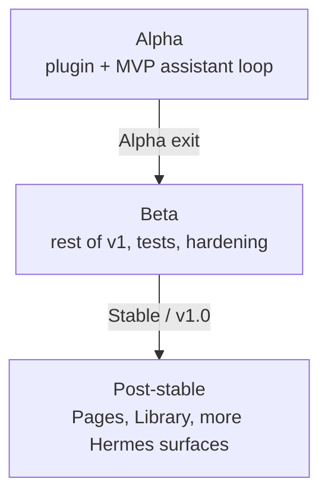

# Hermes Bots — Product roadmap

| Field | Value |
| --- | --- |
| **Product** | Hermes Bots |
| **Document type** | Product roadmap |
| **Version** | 1.0 |
| **Status** | Active |
| **Last updated** | 2026-10-30 |
| **Related** | [PRD](./PRD.md) |

---

## Release model

### Phases

| Phase | Intent |
| --- | --- |
| **Alpha** | Initial development. Goal: the MVP assistant loop (PRD §9) on both Windows and Android. Builds may be unusable until Alpha exit. |
| **Beta** | Add the rest of the v1 features, tests and hardening. Goal: Stable / v1.0. |
| **Post-stable** | After v1.0: new features and Hermes surfaces, as prioritized. |

### Release checkpoints

| Checkpoint | Meaning |
| --- | --- |
| **Alpha exit** | PRD §9 met on both apps; Beta starts |
| **Stable / v1.0** | Every P1 requirement in the PRD ships on both apps; the user can move fully from Discord |

Windows and Android advance together through every milestone. The companion plugin leads, because both apps depend on it.

---

## Alpha

**Goal:** The assistant loop: bots, one chat each, streaming replies, approvals and questions, routines posting into the chat, and push with the app closed.

**Scope source of truth:** [PRD](./PRD.md) P0 requirements and §9 acceptance criteria.

| Milestone | Focus |
| --- | --- |
| **M1 – Companion plugin** | `hbapp` delivery platform (header and footer removed, wait for running replies), push hooks, alert WebSocket route with Hermes's socket check, tests against a Hermes test instance |
| **M2 – Foundations** | Both app shells; Android signing key and Tauri update key kept as GitHub secrets; release builds on every tagged release and in-app updates from them; client types generated from the Hermes contract; Zoetrik design tokens from DESIGN.md; login, reconnect and version check; plugin detection and install from the app |
| **M3 – Bots and chat** | Bot list with row details and ordering; one chat per bot; streaming, markdown, copy, stop; routine messages; read state synced across devices |
| **M4 – Approvals and questions** | Inline approval and question cards, Needs you list, clearing across devices |
| **M5 – Routines** | List, create, edit, pause, resume, run now, delete; schedule picker with cron; delivery to chat and alert |
| **M6 – Push** | Android foreground service with its setup screen; Windows tray and notifications, including notification clicks and the unsigned-installer check; alert toggles |

**Alpha exit:** PRD §9 met on both apps. Starts Beta. Not Stable / v1.0.

**Not required for Alpha exit:** every P1 requirement, ntfy mode, rooms, usage, multiple servers.

---

## Beta

**Goal:** Ship every P1 requirement on both apps and harden the product for daily use.

### v1 features

| Area | Features |
| --- | --- |
| **Chat** | Thinking and tool lines; todo list and file diffs; steer and queue; retry; attachments and pasted images; slash commands; model and reasoning per chat; Summarize; search within the chat; private handoff cards |
| **Routines** | Run history with jump-to-message; templates |
| **Bots** | Bot info; custom avatars synced across devices |
| **Rooms** | Shared channels with several bots and @mentions |
| **Usage** | Cost per reply and per chat; 14-day dashboard by bot |
| **Push** | Android ntfy mode |
| **Connection** | Several servers and switching |

### Quality and readiness

- Tests for the plugin, the generated clients and both apps, run against a Hermes test instance
- Contract and plugin checks run before every Hermes upgrade
- Multi-day soak of the Android foreground service, including reboots and app updates
- Installer and APK signing settled
- Open questions in PRD §10 decided

### Stable / v1.0 means

- Every P1 requirement in the PRD ships on Windows and Android with the same behaviour
- The user chats with their bots on both phone and Windows and gets notifications reliably
- No known P0 bugs; remaining issues are documented and non-blocking

---

## Post-stable

### Likely

| Item | Intent |
| --- | --- |
| **Pages** | Grok Bot's Pages, on both apps |
| **Per-bot Library** | Grok Bot's per-bot Library, on both apps |

### Considered (not committed)

| Theme | Notes |
| --- | --- |
| **Bot management** | Create and edit bots (profiles) from the app |
| **Notifications** | Desktop-first notification routing; avatar as status |
| **Approvals** | Always allow |
| **Chat extras** | Reactions, edit and resend, voice input, read aloud, export, search across all bots |
| **Hermes surfaces** | Bot memory, skills, tools, MCP servers, bot settings, background processes, files, projects, logs |

---

## Document history

| Version | Date | Notes |
| --- | --- | --- |
| 1.0 | 2026-10-30 | Draft roadmap: Alpha (MVP assistant loop), Beta (rest of v1), Post-stable |
