# Hermes Bots architecture

Hermes Bots is a Windows and Android client for a self-hosted Hermes Agent, plus one companion Hermes plugin. There is no separate server. Everything server-side is stock Hermes, Hermes config, or the plugin. The constraints behind this design are in [BLOCKERS.md](BLOCKERS.md).

## Stack

| Part | Stack |
|---|---|
| Windows app | Tauri, with the UI in React and TypeScript (Vite, Tailwind CSS, shadcn/ui) |
| Android app | Kotlin with Jetpack Compose |
| Companion plugin | Python, as a Hermes plugin |

The reasons are in [WINDOWS-FIRST-STACK.md](WINDOWS-FIRST-STACK.md).

## Components

```mermaid
flowchart LR
    win["Windows app<br/>(tray)"]
    android["Android app<br/>(foreground service)"]
    ntfyapp["ntfy app"]
    ntfysh["ntfy.sh"]

    subgraph devbox["devbox (Tailscale)"]
        subgraph dashboard["hermes dashboard :9119"]
            api["/api/ws JSON-RPC, REST<br/>runs every chat turn"]
            dplugin["hermes-bots plugin<br/>push hooks, alert stream route"]
        end
        subgraph gateway["hermes gateway"]
            cron["cron<br/>routine runs"]
            gplugin["hermes-bots plugin<br/>hbapp delivery platform, push hooks"]
        end
        db[("state.db<br/>chats")]
    end

    win -- "HTTPS/WS over Tailscale" --> api
    android -- "HTTPS/WS over Tailscale" --> api
    win -- "alert stream" --> dplugin
    android -- "alert stream" --> dplugin
    api --- db
    cron -- "routine output" --> gplugin
    gplugin -- "writes into chat" --> db
    gplugin -. "alerts" .-> dplugin
    dplugin -. "HTTPS POST (optional)" .-> ntfysh
    ntfysh -.-> ntfyapp
```



- **Clients.** Native networking only (B10). They talk to the dashboard on port 9119 and never to the gateway directly.
- **Dashboard (`hermes dashboard`).** Login, REST, and the JSON-RPC socket `/api/ws`. Every chat, and every turn in it, runs here.
- **Gateway (`hermes gateway`).** Runs cron. Routine output leaves the gateway through the plugin's delivery platform.
- **`hermes-bots` plugin.** Installed and enabled in every bot's profile (B18). It loads in both processes. In the gateway it registers the `hbapp` delivery platform that writes routine output into chats; the dashboard uses the same platform for Run now (B21). In both processes it runs the push hooks and writes alerts to one store at the Hermes root. The launch profile's copy serves the alert stream from the dashboard.
- **ntfy.sh (optional).** Alternative Android push transport, received through the ntfy app. The default needs no push service (see Push).

## Bots and chats

| Concept | Hermes object | Notes |
|---|---|---|
| Bot | Profile | `profiles.list` is the roster. One machine-level dashboard serves every profile |
| Chat | Ordinary dashboard session | One per bot, created with `session.create`. Its stored id is kept in the profile's `ui_meta`. Routines post into it |
| Bot metadata the app adds | `ui_meta` on the profile | Free-form JSON with per-key compare-and-swap (`profiles.configure` with `ui_meta_expected_revisions`) |

The profile's Bot Chat is not used. Its routine delivery always starts an agent turn (B15).

## Routines

A routine is a cron job that posts its output into an existing chat without starting a turn.

- Create it with one `POST /api/cron/jobs?profile=<bot>` and `deliver: "hbapp:session-<stored session id>/<routine name>"`. The routine name in the target is how the adapter labels the output, because unwrapped output carries no job name and Run now carries no job id (B15). It can be combined with other delivery targets. Edit, pause, resume, run now, run history and delete use the other routes under `/api/cron/jobs`.
- Each run is a separate cron session with its own small context. The run can never ask for approval (B4).
- Scheduled runs need the gateway, and Run now runs in the dashboard (B21). Both hand the output to the same delivery function: the live adapter's `send()` in the gateway, `standalone_sender_fn` in the dashboard. That function:
  1. splits the target into the stored session id and the routine name;
  2. recognises the shape of the text and reduces it to the output (see below);
  3. queues the row in the plugin's store and returns, so the send never outlasts Hermes's 60 s limit on Run now (B21).
- A background worker in each process that loads the plugin writes queued rows in order. For each row it takes the chat's turn lease, waiting while a reply runs, appends an assistant-role row while holding it (B16, B20), and then raises the routine alert or the failure alert (see Push).
- No turn starts. The next reply in that chat sees every routine output that fits in its context, together with the user's own messages.
- All of a bot's routines post into its chat. From there the user can ask the bot to change a routine, and the bot edits it with its cron tool.
- Anything risky happens when the user replies, in an ordinary dashboard turn with normal approvals.

Output shapes the adapter handles (B15):

| Shape | How it is recognised | What is kept |
|---|---|---|
| Wrapped (`cron.wrap_response` true, the default) | Starts `Cronjob Response: <name>\n(job_id: <id>)\n-------------\n\n` and ends `\n\nTo stop or manage this job, send me a new message (e.g. "stop reminder <name>").` | The text between header and footer |
| Unwrapped (`cron.wrap_response: false`, per profile) | Neither header nor footer | All of it |
| Failure | The kept text starts `⚠️ Cron '<name>' failed:` | All of it; the alert is "routine failed" |

The row is the bot's own message, so the user's next message never merges into it (B20):

```
[Routine: <routine name>]
<output>
```

The app shows assistant rows that start with `[Routine: …]` as routine messages.

The plugin registers the platform with `ctx.register_platform(name="hbapp", ..., is_connected=<always true>, cron_deliver_env_var=..., target_ref_syntax_fn=parse_nonempty, standalone_sender_fn=...)`. Without `cron_deliver_env_var`, cron refuses `hbapp` as an unknown delivery target. `is_connected` makes Hermes enable the platform in each profile with no `platforms:` config. The adapter class sets `splits_long_messages = True` so the gateway does not cut output at 4000 characters.

## Chats on the dashboard

Every chat uses the dashboard socket directly, the way Hermes Desktop does:

- Connect with a ticket from `POST /api/auth/ws-ticket` (single use, 30 s).
- After `gateway.ready`, send `client.capabilities {server_requests: true}` and heartbeat with `gateway.ping`.
- Send messages with `prompt.submit`. Streaming text, reasoning and tool events arrive as events.
- Approvals and clarifying questions arrive as server requests and are answered with a JSON-RPC result.
- Resume by stored id. Treat a new `replay_epoch` or a truncated replay as a reset and refetch with `session.history`.
- Messages written into a chat from outside (routine output) are added to an open chat's history before its next turn (`_adopt_out_of_band_turns` in `tui_gateway/prompt_turn.py`). Clients learn about them through `sessions.changed` and refetch.

## Model and reasoning per chat

- Model: `config.set {key: "model", value: "<model> --session", session_id}`. Always include `--session`, because a bare model pick can persist globally under some configs. The pick is stored with the session and restored on resume. New chats keep the profile default.
- Reasoning: `config.set {key: "reasoning", value: "<level>", session_id}`. It is stored in the session's `model_config.reasoning_config`.
- Resume is lazy, so `session.info` reports `reasoning_effort: null` until the agent is rebuilt on the next turn. The app shows the stored value until then. `session.resume` has an `eager_build` option that may avoid this (untested).

## Sync across devices

All state lives in Hermes. Clients hold no state of their own: anything they keep locally, such as the login or cached chats, is a copy that Hermes can rebuild.

- Pin, archive, hide and read state are session columns. Write them with `PATCH /api/sessions/{id}` and a body of `{pinned | archived | hidden | unread, request_id, expected_revision}`. `expected_revision` is the session's current `runtime_revision`. Without `request_id` and `expected_revision` the server returns 409.
- `unread: false` sets the shared `last_read_at` watermark to now. There is no per-device read state.
- Other clients learn about changes through `sessions.changed` (empty payload, at most once per 2 s) and refetch.
- Bot-level app data goes in profile `ui_meta`.

## Push

The plugin raises alerts from its hooks, in whichever process runs the turn, and from its delivery platform (B1):

| Source | Alert |
|---|---|
| `on_human_input_request` hook, kind `approval` | "<bot> needs approval" |
| `on_human_input_request` hook, kind `clarify` | "<bot> has a question" |
| `on_human_input_resolved` hook | clear the pending alert |
| `on_session_end` hook with a `turn_id`, at least 60 s after that turn's `pre_llm_call` (configurable) | "<bot> finished" |
| delivery function, after writing routine output | "<bot> has a new routine result" |
| delivery function, after writing a failure | "<bot>'s routine failed" |

- The bot is the profile, read with `get_active_profile_name()` inside the hook.
- Hooks from routine runs (`task_id` starting `cron:`) and `on_session_end` calls without a `turn_id` raise nothing.
- `pre_approval_request` is not used, because it also fires for requests Hermes's `smart` mode settles with nobody asked.

Alerts carry no conversation text: the bot, the kind of event, the stored session id and a time. The app fetches details when opened, and a tap deep-links into the chat.

Hooks run in the gateway, the dashboard and the gateway's cron workers, and every profile has its own copy of the plugin. So all of them append alerts to one SQLite file at the Hermes root, `<root>/plugin-data/hermes-bots/` (WAL mode), with an increasing id. The launch profile's plugin serves the WebSocket route `/api/plugins/hermes-bots/alerts`, which streams new rows after the id the client last saw (`?since=<id>`). Secondary profiles cannot serve plugin WebSockets (B18), so this one route carries every bot's alerts.

- The client connects with a fresh ticket from `POST /api/auth/ws-ticket`, as for `/api/ws`.
- Hermes does not check logins on plugin WebSocket routes (B17). Before accepting, the route calls `hermes_cli.web_server_chat._ws_auth_ok(ws)` and `_ws_request_is_allowed(ws)`, the credential and Host/Origin checks `/api/ws` runs, and closes the socket when either fails.
- The app calls `GET /api/plugins/hermes-bots/info` before opening the socket. That request mounts the route on a dashboard that has just installed the plugin (B17).

### Delivery

| Platform | Mode | How |
|---|---|---|
| Android | Foreground service (default) | The app holds a connection to the alert stream over Tailscale and posts system notifications itself |
| Android | ntfy (optional) | The plugin also POSTs each alert to an ntfy topic; the ntfy app shows it. For ntfy.sh, the topic is reserved behind an access token |
| Windows | Tray | The app runs in the tray, holds the same connection, and shows toast notifications |

Foreground-service setup on Android:

- Request the battery-optimisation exemption with the standard Android prompt.
- Ask the user to set the VPN app (Tailscale) as always-on VPN.
- Detect the phone maker and link to its page on dontkillmyapp.com when it is known to kill background apps.
- Keep the service running when the app is swiped out of recents. Force stop ends it until the app is opened again.
- Use a notification channel with sound for approvals and questions.

## Plugin install from the app

`plugins.manage` on `/api/ws` installs, updates and removes Hermes plugins. Plugins are per profile, so the app runs it once for each bot (B18).

- Install: `{action: "install", identifier: "<git url>#<subdir>", ref: "<40-character commit SHA>", enable: true, profile: "<bot>"}`. Every install goes through Hermes's security scan, and a source outside the Hermes catalog returns a warning.
- Update: the same call with `force: true` and the new `ref`. A pinned install refuses `action: "update"` (B19).
- The plugin is cloned into that profile's `plugins/hermes-bots` and enabled. Its hooks are live at once in the dashboard and the running gateway.
- The `hbapp` platform connects, or picks up new code, only after a gateway restart. The app then calls `POST /api/gateway/restart`, which relies on a supervisor (the systemd service on devbox) to start the gateway again.
- New dashboard code (the alerts route and `/info`) runs only after a dashboard restart, and Hermes has no API for that. When needed, the plugin update screen asks the user to restart the dashboard and shows the exact steps for their setup, such as `systemctl --user restart hermes-dashboard.service` on devbox (B19). This manual step is temporary: a later release makes the restart happen without the user.
- The platform needs no `platforms:` config entry and no env variables.

At connect the app checks every profile:

| Check | Source |
|---|---|
| Installed and enabled, version and pinned SHA on disk | `plugins.manage {action: "list", profile}` (`plugins.list` reports no versions) |
| Version the dashboard is running | `GET /api/plugins/hermes-bots/info` |

A missing or outdated plugin in any profile is offered for install or update. Routines and push for that bot wait until it is done.

## Login

- `POST /auth/password-login` with `{provider: "basic", username, password}` sets the session cookies. The app keeps the cookie jar and nothing else.
- Access tokens last 12 hours and refresh tokens 30 days. A fixed `HERMES_DASHBOARD_BASIC_AUTH_SECRET` keeps sessions valid across restarts.
- When the refresh token expires, the app shows the login screen with the username filled in.

## Versioning

- Pin Hermes to one tag (currently v0.22.5) and do not auto-update.
- Generate client types from `apps/shared/src/gateway-contract.openrpc.json` at the pinned commit.
- At connect, check `/api/status` `version` and `session.info.desktop_contract` (currently 8). Refuse to run against an unknown combination with a clear message.
- Before an upgrade, run the contract checks and the plugin tests against a test instance (BLOCKERS.md, B12).

## Open decisions

- Messages between bots. Hermes's `message_agent` tool is available only in Bot Chat.
- Restarting the dashboard after a plugin update without user steps. Hermes has no API for it (BLOCKERS.md, B19).
