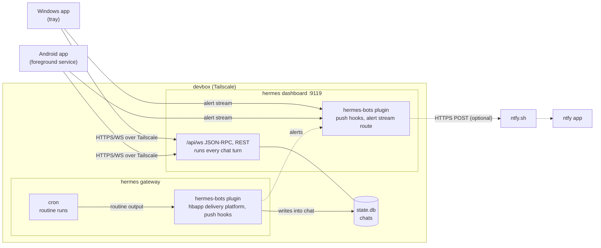

# Hermes Bots architecture

Hermes Bots is a Windows and Android client for a self-hosted Hermes Agent, plus one companion Hermes plugin. There is no separate server. Everything server-side is stock Hermes, Hermes config, or the plugin. The constraints behind this design are in [BLOCKERS.md](BLOCKERS.md).

## Components

- **Clients.** Native networking only (B10). They talk to the dashboard on port 9119 and never to the gateway directly.
- **Dashboard (`hermes dashboard`).** Login, REST, and the JSON-RPC socket `/api/ws`. Every chat, and every turn in it, runs here.
- **Gateway (`hermes gateway`).** Runs cron. Routine output leaves the gateway through the plugin's delivery platform.
- **`hermes-bots` plugin.** Installed in the Hermes home and enabled in `plugins.enabled`. It loads in both processes. In the gateway it registers the `hbapp` delivery platform that writes routine output into chats. In both processes it runs the push hooks, and in the dashboard it serves the alert stream.
- **ntfy.sh (optional).** Alternative Android push transport, received through the ntfy app. The default needs no push service (see Push).

## Bots and chats

| Concept | Hermes object | Notes |
|---|---|---|
| Bot | Profile | `profiles.list` is the roster. One machine-level dashboard serves every profile |
| Chat | Ordinary dashboard session | One per bot, created with `session.create`. Its stored id is kept in the profile's `ui_meta`. Routines post into it |
| Bot metadata the app adds | `ui_meta` on the profile | Free-form JSON with per-key compare-and-swap (`profiles.configure` with `ui_meta_expected_revisions`) |

The profile's Bot Chat is not used. Its routine delivery always starts an agent turn (B15).

## Routines

A routine is a cron job that posts its output into an existing chat without starting a turn.

- Create it with one `POST /api/cron/jobs` and `deliver: "hbapp:session-<stored session id>"`. It can be combined with other delivery targets. Edit, pause, resume, run now, run history and delete use the other routes under `/api/cron/jobs`.
- Each run is a separate cron session with its own small context. The run can never ask for approval (B4).
- The gateway hands the output to the plugin's `hbapp` adapter. The adapter:
  1. removes the Hermes header (`Cronjob Response: <name>`, the job id and the separator line) and the "To stop…" footer;
  2. waits until no reply is running in the target chat (B16);
  3. appends the text to the chat as a user-role message prefixed `[Routine: <name>]`, using `gateway.mirror.mirror_to_session(..., role="user", session_id=<stored id>)`;
  4. raises the routine alert (see Push).
- No turn starts. The next reply in that chat sees every routine output that fits in its context, together with the user's own messages.
- All of a bot's routines post into its chat. From there the user can ask the bot to change a routine, and the bot edits it with its cron tool.
- Anything risky happens when the user replies, in an ordinary dashboard turn with normal approvals.
- The app shows messages with the `[Routine: …]` prefix as routine output.

The plugin registers the platform with `ctx.register_platform(name="hbapp", ..., cron_deliver_env_var=...)`. Without `cron_deliver_env_var`, cron refuses `hbapp` as an unknown delivery target.

## Chats on the dashboard

Every chat uses the dashboard socket directly, the way Hermes Desktop does:

- Connect with a ticket from `POST /api/auth/ws-ticket` (single use, 30 s).
- After `gateway.ready`, send `client.capabilities {server_requests: true}` and heartbeat with `gateway.ping`.
- Send messages with `prompt.submit`. Streaming text, reasoning and tool events arrive as events.
- Approvals and clarifying questions arrive as server requests and are answered with a JSON-RPC result.
- Resume by stored id. Treat a new `replay_epoch` or a truncated replay as a reset and refetch with `session.history`.
- Messages written into a chat from outside (routine output) are added to an open chat's history before its next turn (`_adopt_out_of_band_turns` in `tui_gateway/prompt_turn.py`). Clients learn about them through `sessions.changed` and refetch.

## Model and reasoning per chat

- Model: `config.set {key: "model", value: "<model> --session", session_id}`. Always include `--session`, because a bare model pick can persist globally under some configs. The pick is stored with the session and restored on resume. New chats keep the profile default.
- Reasoning: `config.set {key: "reasoning", value: "<level>", session_id}`. It is stored in the session's `model_config.reasoning_config`.
- Resume is lazy, so `session.info` reports `reasoning_effort: null` until the agent is rebuilt on the next turn. The app shows the stored value until then. `session.resume` has an `eager_build` option that may avoid this (untested).

## Sync across devices

All state lives in Hermes. Clients hold no state of their own: anything they keep locally, such as the login or cached chats, is a copy that Hermes can rebuild.

- Pin, archive, hide and read state are session columns. Write them with `PATCH /api/sessions/{id}` and a body of `{pinned | archived | hidden | unread, request_id, expected_revision}`. `expected_revision` is the session's current `runtime_revision`. Without `request_id` and `expected_revision` the server returns 409.
- `unread: false` sets the shared `last_read_at` watermark to now. There is no per-device read state.
- Other clients learn about changes through `sessions.changed` (empty payload, at most once per 2 s) and refetch.
- Bot-level app data goes in profile `ui_meta`.

## Push

The plugin raises alerts from its hooks, in whichever process runs the turn, and from its delivery platform:

| Source | Alert |
|---|---|
| `pre_approval_request` hook | "<bot> needs approval" |
| `on_human_input_request` hook (kind `clarify`) | "<bot> has a question" |
| `post_approval_response`, `on_human_input_resolved` hooks | clear the pending alert |
| `on_session_end` hook | "<bot> finished" (for long turns) |
| `hbapp` adapter, after writing routine output | "<bot> has a new routine result" |

Alerts carry no conversation text, only the bot and the kind of event. The app fetches details when opened, and a tap deep-links into the chat. The plugin keeps the alerts and serves them from a dashboard route, so alerts raised in the gateway and in the dashboard feed one stream.

### Delivery

| Platform | Mode | How |
|---|---|---|
| Android | Foreground service (default) | The app holds a connection to the alert stream over Tailscale and posts system notifications itself |
| Android | ntfy (optional) | The plugin also POSTs each alert to an ntfy topic; the ntfy app shows it. For ntfy.sh, the topic is reserved behind an access token |
| Windows | Tray | The app runs in the tray, holds the same connection, and shows toast notifications |

Foreground-service setup on Android:

- Request the battery-optimisation exemption with the standard Android prompt.
- Ask the user to set the VPN app (Tailscale) as always-on VPN.
- Detect the phone maker and link to its page on dontkillmyapp.com when it is known to kill background apps.
- Keep the service running when the app is swiped out of recents. Force stop ends it until the app is opened again.
- Use a notification channel with sound for approvals and questions.

## Plugin install from the app

`plugins.manage` on `/api/ws` installs, updates and removes Hermes plugins.

- Install: `{action: "install", identifier, enable: true}`, with an optional `ref`. The identifier is a Git URL. Every install goes through Hermes's security scan, and a source outside the Hermes catalog returns a warning.
- The plugin is cloned, enabled, and its hooks are live in the dashboard and the running gateway at once. The result reports `restart_required: false` and `gateway_reloaded: true`.
- The `hbapp` delivery platform connects only after a gateway restart. The app then calls `POST /api/gateway/restart`, which relies on a supervisor (the systemd service on devbox) to start the gateway again.
- The platform needs no `platforms:` config entry and no env variables.
- A missing or outdated `hermes-bots` plugin is detected at connect, and the app offers to install or update it.

## Login

- `POST /auth/password-login` with `{provider: "basic", username, password}` sets the session cookies. The app keeps the cookie jar and nothing else.
- Access tokens last 12 hours and refresh tokens 30 days. A fixed `HERMES_DASHBOARD_BASIC_AUTH_SECRET` keeps sessions valid across restarts.
- When the refresh token expires, the app shows the login screen with the username filled in.

## Versioning

- Pin Hermes to one tag (currently v0.22.5) and do not auto-update.
- Generate client types from `apps/shared/src/gateway-contract.openrpc.json` at the pinned commit.
- At connect, check `/api/status` `version` and `session.info.desktop_contract` (currently 8). Refuse to run against an unknown combination with a clear message.
- Before an upgrade, run the contract checks and the plugin tests against a test instance (BLOCKERS.md, B12).

## Open decisions

- Desktop and mobile stack.
- Alert stream transport: WebSocket route or long-polling.
- Messages between bots. Hermes's `message_agent` tool is available only in Bot Chat.
